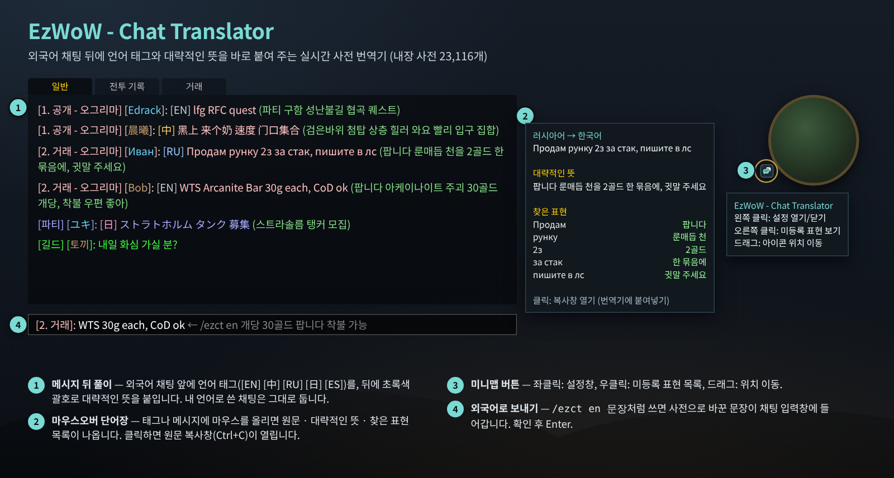
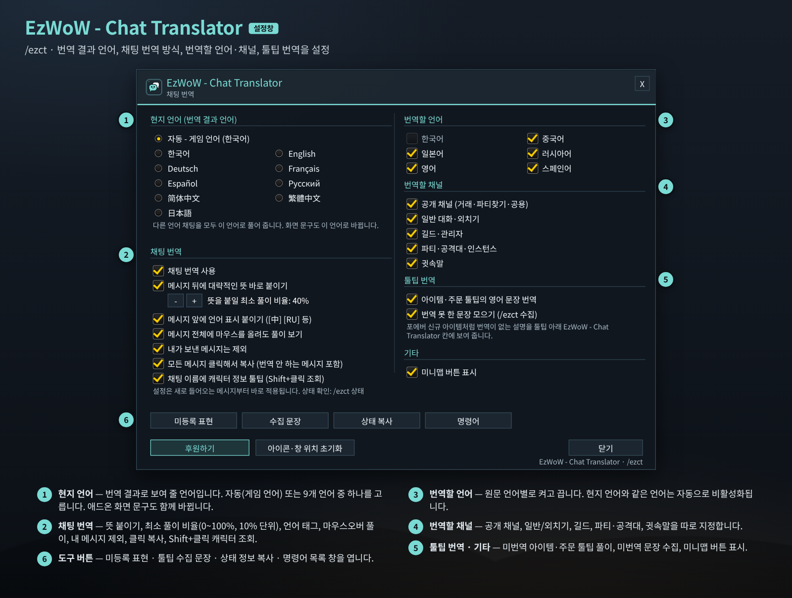
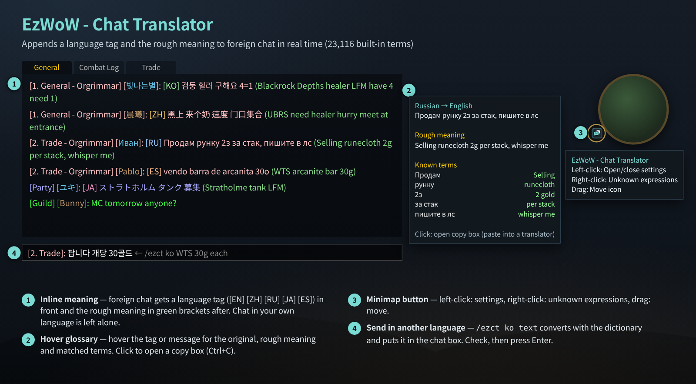
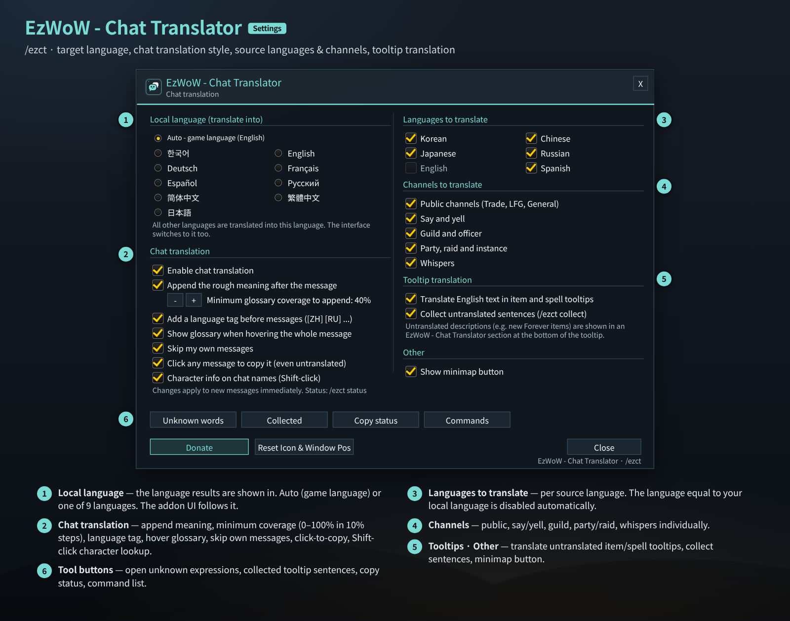

# EzWoW - Chat Translator (`EzWoW-ChatTranslator`)

## CurseForge

- **Project ID / 프로젝트 ID:** `1733319`
- **Project page / 프로젝트 페이지:** [EzWoW-ChatTranslator](https://www.curseforge.com/wow/addons/wowchattranslator)

**[한국어](#한국어) · [English](#english)**

WoW Forever (`Interface: 16001`) · `v1.5.0` · `/ezct`

---

## 한국어

### 개요

외국어 채팅 뒤에 **언어 태그와 대략적인 뜻**을 바로 붙여 주는 실시간 사전 번역 애드온입니다. 인터넷 번역기를 쓰지 않고, 애드온에 들어 있는 **23,116개 와우 용어·은어·약어 사전**(던전, 직업, 아이템, 모집·거래 표현 등)으로 단어 단위로 풀어 줍니다. 번역이 빠진 아이템·주문 툴팁도 풀어 주고, 내 문장을 외국어로 바꿔 보내는 기능도 있습니다.

- 지원 언어: 한국어, English, Deutsch, Français, Español, Русский, 简体中文, 繁體中文, 日本語 (+ 자동)
- 사전 번역이라 문장 전체를 매끄럽게 번역하지는 않습니다. **“무슨 뜻인지 감을 잡는” 용도**로 쓰세요.

### 화면 미리보기

> 이미지는 애드온 코드의 창 크기·좌표·색상·문구로 재현한 **예시 화면**입니다. 채팅 내용은 예시입니다.

### 설치

1. `EzWoW-ChatTranslator` 폴더를 `Interface/AddOns/` 폴더에 넣습니다.
2. 캐릭터 선택 화면의 **애드온** 목록에서 켭니다.
3. 접속하면 바로 동작합니다. 설정은 `/ezct` 또는 미니맵 버튼 좌클릭으로 엽니다.

### 기능 상세 (위 그림의 번호)

| 번호 | 기능 | 설명 |
|---|---|---|
| ① | 메시지 뒤 풀이 | 외국어 채팅 앞에 언어 태그(`[EN]` `[中]` `[RU]` `[日]` `[ES]` …)를 붙이고, 뒤에 **초록색 괄호**로 대략적인 뜻을 붙입니다. 사전에서 찾은 비율이 **최소 풀이 비율**(기본 40%)보다 낮으면 뜻을 붙이지 않고 태그만 붙입니다. |
| ② | 마우스오버 단어장 | 태그(또는 메시지 전체)에 마우스를 올리면 원문, 대략적인 뜻, **찾은 표현** 목록이 툴팁으로 나옵니다. 클릭하면 원문을 복사할 수 있는 창(Ctrl+C)이 열려 외부 번역기에 붙여 넣을 수 있습니다. |
| ③ | 미니맵 버튼 | 좌클릭: 설정창 / 우클릭: 미등록 표현 목록 / 드래그: 위치 이동 |
| ④ | 외국어로 보내기 | `/ezct en 개당 30골드 팝니다`처럼 쓰면 사전으로 바꾼 문장이 **채팅 입력창**에 들어갑니다. 내용을 확인한 뒤 Enter로 보냅니다. 바꾸지 못한 부분은 채팅창에 따로 알려 줍니다. |

#### 그 밖의 기능

- **숫자·모집 표현 해석**: `30g`, `1.5k`, `lvl40`, `lf2m`, `8pm`, `4=1`(4명 있음, 1명 구함), 한/영 자판 실수, `invvvvv` 같은 늘어진 철자도 알아듣습니다.
- **채팅 이름 캐릭터 정보**: 채팅창의 캐릭터 이름을 **Shift + 좌클릭**하면 레벨·종족·직업·길드를 조회해(최소 3초 간격, 2초 대기) 이름 툴팁에 보여 줍니다.
- **툴팁 번역**: 번역이 없는 영어 아이템·주문·세트 효과·전문기술 문장을 툴팁 아래 `EzWoW - Chat Translator` 칸에 번역해 보여 줍니다.
- **미등록 표현 수집**: 사전에 없는 외국어 채팅 예문(`/ezct 미등록`)과 툴팁 미번역 문장(`/ezct 수집`)을 모아 복사창으로 보여 줍니다. 사전 보강에 쓸 수 있습니다.
- **나만의 단어장**: `/ezct add 단어=뜻`으로 길드 약어 등을 직접 등록하면 번역에 함께 쓰입니다.

### 설정창 (`/ezct`)

| 번호 | 영역 | 항목 | 기본값 |
|---|---|---|---|
| ① | 현지 언어 (번역 결과 언어) | 자동(게임 언어) 또는 9개 언어 중 하나. 애드온 화면 문구도 이 언어로 바뀝니다. | 자동 |
| ② | 채팅 번역 | 채팅 번역 사용 | 켬 |
| ② | | 메시지 뒤에 대략적인 뜻 바로 붙이기 | 켬 |
| ② | | 뜻을 붙일 최소 풀이 비율 (`-`/`+`, 0~100%, 10% 단위) | 40% |
| ② | | 메시지 앞에 언어 표시 붙이기 | 켬 |
| ② | | 메시지 전체에 마우스를 올려도 풀이 보기 | 켬 |
| ② | | 내가 보낸 메시지는 제외 | 켬 |
| ② | | 모든 메시지 클릭해서 복사 (번역 안 하는 메시지 포함) | 켬 |
| ② | | 채팅 이름에 캐릭터 정보 툴팁 (Shift+클릭 조회) | 켬 |
| ③ | 번역할 언어 | 한국어·중국어·일본어·러시아어·영어·스페인어 원문을 각각 켜고 끕니다. **현지 언어와 같은 언어는 자동으로 꺼지고 회색**이 됩니다. | 모두 켬 |
| ④ | 번역할 채널 | 공개 채널(거래·파티찾기·공용), 일반 대화·외치기, 길드·관리자, 파티·공격대·인스턴스, 귓속말 | 모두 켬 |
| ⑤ | 툴팁 번역 | 아이템·주문 툴팁의 영어 문장 번역 / 번역 못 한 문장 모으기 | 켬 / 켬 |
| ⑤ | 기타 | 미니맵 버튼 표시 | 켬 |
| ⑥ | 도구 버튼 | 미등록 표현 · 수집 문장 · 상태 복사 · 명령어 창 열기 | - |
| | 하단 | 후원하기 / 아이콘·창 위치 초기화 / 닫기 | - |

### 명령어 (`/ezct`, `/번역`, `/외국어`)

| 명령어 | 설명 |
|---|---|
| `/ezct` | 설정창 열기/닫기 |
| `/ezct on` · `/ezct off` (`켜기` · `끄기`) | 채팅 번역 빠르게 켜기/끄기 |
| `/ezct lang <auto\|ko\|en\|de\|fr\|es\|ru\|zhCN\|zhTW\|ja>` | 현지(결과) 언어 변경 |
| `/ezct <en\|de\|fr\|es\|ru\|zh\|tw\|ja\|ko> 문장` | 문장을 그 언어로 바꿔 채팅 입력창에 넣기 |
| `/ezct search 단어` (`/ezct 검색 단어`) | 내장 사전 + 내 단어장 검색 |
| `/ezct add 단어=뜻` · `/ezct del 단어` · `/ezct list` | 내 단어 추가 · 삭제 · 목록 |
| `/ezct unknown` (`/ezct 미등록`) | 수집된 미등록 채팅 표현 보기 |
| `/ezct collect` (`/ezct 수집`) · `/ezct 수집 초기화` | 툴팁 미번역 문장 보기 · 지우기 |
| `/ezct test 문장` (`테스트`) | 문장을 넣어 풀이 결과 시험 |
| `/ezct status` (`상태`) | 상태 정보 출력 |

### 저장 데이터

- `EzWoW_ChatTranslatorDB` (계정 공통): 설정, 내 단어장, 수집한 문장, 미니맵 버튼 위치.

### 알아두면 좋은 점

- 같은 언어로 쓴 채팅(예: 한국어 클라이언트의 한국어 채팅)은 건드리지 않습니다.
- 설정 변경은 **새로 들어오는 메시지부터** 적용됩니다.
- 독일어·프랑스어는 결과 언어로는 지원되지만 번역표가 작아(각 965개) 부족한 부분은 영어로 나옵니다.

---

## English

### Overview

Chat Translator appends a **language tag and a rough meaning** to foreign-language chat in real time. It does not use an online translator: it breaks messages down with a built-in **dictionary of 23,116 WoW terms, slang and abbreviations** (dungeons, classes, items, LFG/trade phrases…). It can also translate untranslated item/spell tooltips and convert your own message into another language.

- Languages: 한국어, English, Deutsch, Français, Español, Русский, 简体中文, 繁體中文, 日本語 (+ Auto)
- It is a dictionary translator, not a fluent sentence translator. Use it to **get the gist**.

### Screenshots

> These are **mock-ups** rebuilt from the window sizes, coordinates, colours and strings in the addon code. Chat lines are examples.

### Installation

1. Copy the `EzWoW-ChatTranslator` folder into `Interface/AddOns/`.
2. Enable it in the **AddOns** list on the character select screen.
3. It works right after login. Open settings with `/ezct` or by left-clicking the minimap button.

### Features (numbers in the picture)

| No. | Feature | Description |
|---|---|---|
| ① | Inline meaning | Adds a language tag (`[EN]` `[ZH]` `[RU]` `[JA]` `[ES]` …) before foreign chat and the rough meaning in **green brackets** after it. If the share of recognised words is below the **minimum coverage** (40% by default), only the tag is added. |
| ② | Hover glossary | Hover the tag (or the whole message) for the original text, rough meaning and the list of **known terms**. Click to open a copy box (Ctrl+C) so you can paste it into an external translator. |
| ③ | Minimap button | Left-click: settings / right-click: unknown expressions / drag: move |
| ④ | Send in another language | `/ezct ko WTS 30g each` converts the text with the dictionary and puts it into the **chat input box**. Check it and press Enter. Parts it could not convert are listed in the chat frame. |

#### More features

- **Numbers and LFG patterns**: understands `30g`, `1.5k`, `lvl40`, `lf2m`, `8pm`, `4=1` (have 4, need 1), Korean/English keyboard-layout mistakes and stretched spellings like `invvvvv`.
- **Character info on chat names**: **Shift + left-click** a name in chat to look up level, race, class and guild (at most once every 3 s, 2 s timeout) and show it in the name tooltip.
- **Tooltip translation**: untranslated English item, spell, set-bonus and profession lines are translated in an `EzWoW - Chat Translator` section at the bottom of the tooltip.
- **Collecting unknown text**: foreign chat with no dictionary match (`/ezct unknown`) and untranslated tooltip lines (`/ezct collect`) are collected into a copy box, useful for extending the dictionary.
- **Your own words**: `/ezct add word=meaning` registers guild slang etc. and uses it in translations.

### Settings window (`/ezct`)

| No. | Section | Option | Default |
|---|---|---|---|
| ① | Local language (translate into) | Auto (game language) or one of 9 languages. The addon UI switches too. | Auto |
| ② | Chat translation | Enable chat translation | On |
| ② | | Append the rough meaning after the message | On |
| ② | | Minimum glossary coverage to append (`-`/`+`, 0–100%, steps of 10) | 40% |
| ② | | Add a language tag before messages | On |
| ② | | Show glossary when hovering the whole message | On |
| ② | | Skip my own messages | On |
| ② | | Click any message to copy it (even untranslated) | On |
| ② | | Character info on chat names (Shift-click) | On |
| ③ | Languages to translate | Korean, Chinese, Japanese, Russian, English, Spanish sources individually. **The language equal to your local language is turned off and greyed out.** | All on |
| ④ | Channels to translate | Public (Trade, LFG, General), say/yell, guild/officer, party/raid/instance, whispers | All on |
| ⑤ | Tooltip translation | Translate English text in item and spell tooltips / Collect untranslated sentences | On / On |
| ⑤ | Other | Show minimap button | On |
| ⑥ | Tool buttons | Unknown words · Collected · Copy status · Commands | - |
| | Bottom | Donate / Reset Icon & Window Pos / Close | - |

### Slash commands (`/ezct`, `/번역`, `/외국어`)

| Command | Description |
|---|---|
| `/ezct` | Open/close settings |
| `/ezct on` · `/ezct off` | Quickly toggle chat translation |
| `/ezct lang <auto\|ko\|en\|de\|fr\|es\|ru\|zhCN\|zhTW\|ja>` | Change the local (result) language |
| `/ezct <en\|de\|fr\|es\|ru\|zh\|tw\|ja\|ko> text` | Convert text into that language and put it into the chat box |
| `/ezct search word` | Search the built-in dictionary and your words |
| `/ezct add word=meaning` · `/ezct del word` · `/ezct list` | Add · remove · list your words |
| `/ezct unknown` | Show collected unknown chat expressions |
| `/ezct collect` · `/ezct collect clear` | Show · clear untranslated tooltip sentences |
| `/ezct test text` | Test how a message is translated |
| `/ezct status` | Print status information |

### Saved data

- `EzWoW_ChatTranslatorDB` (account-wide): settings, your words, collected sentences, minimap button position.

### Tips

- Chat already in your local language is left untouched.
- Setting changes apply **to new messages**.
- German and French work as result languages, but their tables are small (965 entries each); missing parts fall back to English.
