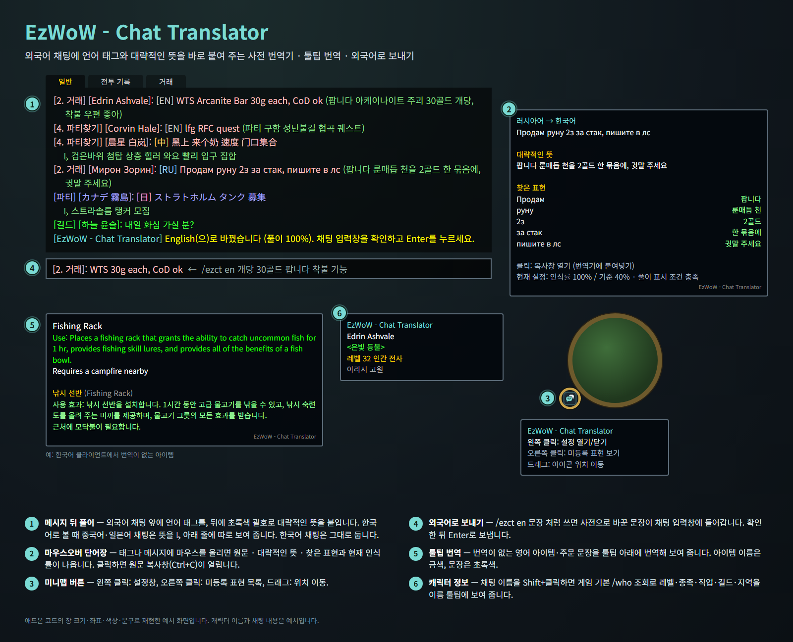
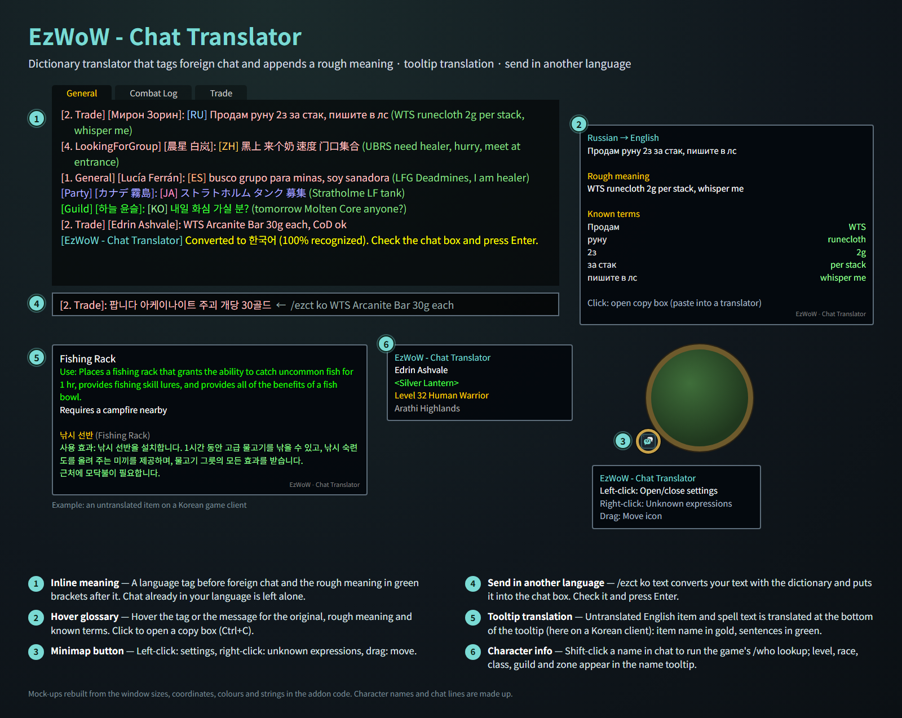

# EzWoW - Chat Translator (`EzWoW-ChatTranslator`)

## CurseForge

- **Project ID / 프로젝트 ID:** `1733319`
- **Project page / 프로젝트 페이지:** [EzWoW-ChatTranslator](https://www.curseforge.com/wow/addons/wowchattranslator)

**[한국어](#한국어) · [English](#english)**

WoW Forever (`Interface: 16001`) · `/ezct`

---

## 한국어

### 개요

외국어 채팅 앞뒤에 **언어 태그와 대략적인 뜻**을 바로 붙여 주는 실시간 사전 번역 애드온입니다. 인터넷 번역을 쓰지 않고, 애드온에 들어 있는 **23,116개 와우 용어·은어·약어 사전**(던전, 직업, 아이템, 모집·거래 표현 등)으로 단어 단위로 풀어 줍니다. 번역이 빠진 아이템·주문 툴팁도 풀어 주고, 내 문장을 외국어로 바꿔 보내는 기능과 채팅 이름의 캐릭터 정보 툴팁도 있습니다.

- 결과 언어: 한국어, English, Deutsch, Français, Español, Русский, 简体中文, 繁體中文, 日本語 (+ 자동)
- 원문 언어: 한국어, 영어, 중국어, 일본어, 러시아어, 스페인어
- 사전 번역이라 문장 전체를 매끄럽게 번역하지는 않습니다. **“무슨 뜻인지 감을 잡는” 용도**로 쓰세요.

### 화면 미리보기

> 실제 게임 화면입니다(WoW Forever, 한국어 클라이언트). 캐릭터 · 다른 플레이어 이름과 채팅 내용은 가렸습니다.

### 설치

1. `EzWoW-ChatTranslator` 폴더를 `Interface/AddOns/` 폴더에 넣습니다.
2. 캐릭터 선택 화면의 **애드온** 목록에서 켭니다.
3. 접속하면 바로 동작합니다. 설정은 `/ezct`, 미니맵 버튼 왼쪽 클릭, 또는 게임 설정의 **애드온 → EzWoW - Chat Translator**에서 엽니다.

### 기능 상세

| 번호 | 기능 | 설명 |
|---|---|---|
| ① | 메시지 뒤 풀이 | 외국어 채팅 앞에 언어 태그(`[EN]` `[中]` `[RU]` `[日]` `[ES]` …)를 붙이고, 뒤에 **초록색 괄호**로 대략적인 뜻을 붙입니다. 결과 언어가 한국어일 때 중국어·일본어 채팅의 뜻은 한자가 섞이지 않도록 **아래 줄(`↳`)에 따로** 보여 줍니다. 사전에서 찾은 비율이 **최소 풀이 비율**(기본 40%)보다 낮으면 뜻을 붙이지 않고 태그만 붙입니다. |
| ② | 마우스오버 단어장 | 태그(또는 메시지 전체)에 마우스를 올리면 원문, 대략적인 뜻, **찾은 표현** 목록이 툴팁으로 나옵니다. 한국어로 볼 때는 현재 인식률과 기준, 뜻이 붙었는지 여부도 함께 보여 줍니다. 클릭하면 원문을 복사할 수 있는 창(Ctrl+C)이 열립니다. |
| ③ | 미니맵 버튼 | 왼쪽 클릭: 설정창 / 오른쪽 클릭: 미등록 표현 목록 / 드래그: 위치 이동 |
| ④ | 외국어로 보내기 | `/ezct en 개당 30골드 팝니다`처럼 쓰면 사전으로 바꾼 문장이 **채팅 입력창**에 들어갑니다. 내용을 확인한 뒤 Enter로 보냅니다. 바꾸지 못한 부분은 채팅창에 따로 알려 줍니다. |
| ⑤ | 툴팁 번역 | 번역이 없는 영어 아이템·주문·세트 효과·전문기술 문장을 툴팁 아래에 번역해 보여 줍니다. 아이템 이름은 금색(원문은 회색 괄호), 번역 문장은 초록색이고, 맨 아래에 작은 회색 글씨로 `EzWoW - Chat Translator`가 표시됩니다. |
| ⑥ | 캐릭터 정보 | 채팅창의 캐릭터 이름을 **Shift + 왼쪽 클릭**하면 게임 기본 /who 조회가 실행되고, 그 결과의 레벨·종족·직업·길드·지역을 이름 툴팁에 보여 줍니다(최대 2초 대기). 파티·공격대원, 대상, 길드원은 조회 없이 바로 보여 줍니다. |

#### 그 밖의 기능

- **숫자·모집 표현 해석**: `30g`, `1.5k`, `lvl40`, `lf2m`, `8pm`, `4=1`(4명 있음, 1명 구함), 한/영 자판 실수, `invvvvv` 같은 늘어진 철자도 알아듣습니다.
- **클릭해서 복사**: 번역하지 않는 메시지도 클릭하면 복사창이 열립니다(설정에서 끌 수 있음).
- **미등록 표현 수집**: 사전에 없는 외국어 채팅 예문(`/ezct 미등록`)과 툴팁 미번역 문장(`/ezct 수집`)을 모아 복사창으로 보여 줍니다. 한글이 들어간 글, 괄호 안 이름(길드·아이템), 자판 두드리기는 빼고 모읍니다.
- **사전 키우기에 참여**: 표현이 20개 넘게 모이면 채팅창에 한 번 안내가 나옵니다. **[목록 복사]**를 눌러 Ctrl+C로 복사한 뒤 **[애드온 댓글 페이지]**(주소 복사)에 붙여 주시면 다음 업데이트 사전에 넣습니다. 다른 지역 서버의 채팅은 개발자에게 닿지 않아 이렇게 받습니다.
- **나만의 단어장**: `/ezct add 단어=뜻`으로 길드 약어 등을 직접 등록하면 번역에 함께 쓰입니다.

### 설정창 (`/ezct`)

| 번호 | 영역 | 항목 | 기본값 |
|---|---|---|---|
| ① | 현지 언어 (번역 결과 언어) | 상자를 누르면 목록이 열립니다. 자동(게임 언어) 또는 9개 언어 중 하나를 고릅니다. 애드온 화면 문구도 이 언어로 바뀝니다. | 자동 |
| ② | 채팅 번역 | 채팅 번역 사용 | 켬 |
| ② | | 메시지 뒤에 대략적인 뜻 바로 붙이기 | 켬 |
| ② | | 뜻을 붙일 최소 풀이 비율 (`-`/`+`, 0~100%, 10% 단위) | 40% |
| ② | | 메시지 앞에 언어 표시 붙이기 | 켬 |
| ② | | 메시지 전체에 마우스를 올려도 풀이 보기 | 켬 |
| ② | | 내가 보낸 메시지는 제외 | 켬 |
| ② | | 모든 메시지 클릭해서 복사 (번역 안 하는 메시지 포함) | 켬 |
| ② | | 채팅 이름에 캐릭터 정보 툴팁 (Shift+클릭 조회) | 켬 |
| ③ | 번역할 언어 | 한국어·중국어·일본어·러시아어·영어·스페인어 원문을 각각 켜고 끕니다. **현지 언어와 같은 언어는 자동으로 꺼지고 회색**이 됩니다. | 모두 켬 |
| ④ | 번역할 채널 | 공개 채널(거래·파티찾기·공용), 일반 대화·외치기, 길드·관리자, 파티·공격대·인스턴스, 귓속말 | 모두 켬 |
| ⑤ | 툴팁 번역 | 아이템·주문 툴팁의 영어 문장 번역 / 번역 못 한 문장 모으기 | 켬 / 켬 |
| ⑤ | 기타 | 미니맵 버튼 표시 | 켬 |
| ⑥ | 도구 버튼 | 미등록 표현 · 수집 문장 · 상태 복사 · 명령어 창 열기 | - |
| | 하단 | 후원하기 / 아이콘·창 위치 초기화 / 닫기 | - |

### 명령어 (`/ezct`, `/번역`, `/외국어`)

| 명령어 | 설명 |
|---|---|
| `/ezct` | 설정창 열기/닫기 |
| `/ezct on` · `/ezct off` (`켜기` · `끄기`) | 채팅 번역 빠르게 켜기/끄기 |
| `/ezct lang <auto\|ko\|en\|de\|fr\|es\|ru\|zhCN\|zhTW\|ja>` (`언어`) | 현지(결과) 언어 변경 |
| `/ezct <en\|de\|fr\|es\|ru\|zh\|tw\|ja\|ko> 문장` | 문장을 그 언어로 바꿔 채팅 입력창에 넣기 |
| `/ezct search 단어` (`검색`) | 내장 사전 + 내 단어장 검색 |
| `/ezct add 단어=뜻` · `/ezct del 단어` · `/ezct list` (`추가` · `삭제` · `목록`) | 내 단어 추가 · 삭제 · 목록 |
| `/ezct unknown` (`미등록`) | 수집된 미등록 채팅 표현 보기 |
| `/ezct collect` (`수집`) · `/ezct 수집 초기화` | 툴팁 미번역 문장 보기 · 지우기 |
| `/ezct test 문장` (`테스트`) | 문장을 넣어 풀이 결과 시험 |
| `/ezct status` (`상태`) | 상태 정보 출력 |
| `/ezct help` (`명령어`) | 명령어 목록 창 |

### 저장 데이터

- `EzWoW_ChatTranslatorDB` (계정 공통): 설정, 내 단어장, 수집한 문장, 미니맵 버튼 위치.

### 알아두면 좋은 점

- 같은 언어로 쓴 채팅(예: 한국어 클라이언트의 한국어 채팅)은 건드리지 않습니다.
- 설정 변경은 **새로 들어오는 메시지부터** 적용됩니다.
- 따로 떨어진 뜻 줄(`↳`)은 원래 메시지가 실제로 표시된 채팅창에만 나옵니다.
- 배틀넷 귓속말은 게임이 보낸 사람 정보를 애드온에 공개하지 않아 번역하지 않습니다.
- 독일어·프랑스어는 결과 언어로는 지원되지만 번역표가 작아(각 965개) 부족한 부분은 영어로 나옵니다.

<!-- ezwow-pad-share -->
### 게임패드
- 게임패드 UI를 켜면 EzWoW 창을 패드로 다룰 수 있습니다. 방향키로 이동, A(✕)로 누르기, X(□)로 오른쪽 클릭, LB/RB로 스크롤, B(○)로 닫기입니다. 창 아래에 연결된 패드 모양으로 키 안내가 나옵니다.
- 블리자드 창이 열려 있지 않을 때 **보기(Back) / Create 버튼**을 누르면 화면의 EzWoW 프레임(유틸리티 바, 퀘스트 목록 등)으로 이동합니다. 다시 누르거나 B를 누르면 돌아갑니다.
- 다른 버튼을 쓰려면 설정 > 단축키 > 애드온 > EzWoW > "게임패드: EzWoW 창으로 이동/돌아가기"에 지정합니다(EzWoW-MapFinder가 설치돼 있을 때).

### 기록 공유
- 모든 EzWoW 애드온이 함께 쓰는 기록 공유가 **기본으로 켜져 있습니다**. 직접 확인한 퀘스트 NPC, 희귀 몬스터 목격, 아이템 드롭, 채집 위치를 다른 EzWoW 사용자와 나눕니다.
- `/ezshare` 또는 `/공유`: `on` / `off` 켜기·끄기, `channel on` / `channel off` 서버 채널 사용, `status` 현재 상태와 기록 수.

---

## English

### Overview

Chat Translator adds a **language tag and a rough meaning** to foreign-language chat in real time. It does not use an online translation service: it breaks messages down with a built-in **dictionary of 23,116 WoW terms, slang and abbreviations** (dungeons, classes, items, LFG/trade phrases…). It also translates untranslated item/spell tooltips, converts your own message into another language and shows character info on chat names.

- Result languages: 한국어, English, Deutsch, Français, Español, Русский, 简体中文, 繁體中文, 日本語 (+ Auto)
- Source languages: Korean, English, Chinese, Japanese, Russian, Spanish
- It is a dictionary translator, not a fluent sentence translator. Use it to **get the gist**.

### Screenshots

> In-game screenshots with the addon set to English. The game client is Korean, so game text such as zone, item and spell names stays Korean. Character and player names and chat text are blurred.

### Installation

1. Copy the `EzWoW-ChatTranslator` folder into `Interface/AddOns/`.
2. Enable it in the **AddOns** list on the character select screen.
3. It works right after login. Open settings with `/ezct`, by left-clicking the minimap button, or from the game's **Options → AddOns → EzWoW - Chat Translator**.

### Features

| No. | Feature | Description |
|---|---|---|
| ① | Inline meaning | Adds a language tag (`[EN]` `[ZH]` `[RU]` `[JA]` `[ES]` …) before foreign chat and the rough meaning in **green brackets** after it. When the result language is Korean, the meaning of Chinese and Japanese chat goes on **its own line (`↳`)** below. If the share of recognised words is below the **minimum coverage** (40% by default), only the tag is added. |
| ② | Hover glossary | Hover the tag (or the whole message) for the original text, rough meaning and the list of **known terms**. Click to open a copy box (Ctrl+C). |
| ③ | Minimap button | Left-click: settings / right-click: unknown expressions / drag: move |
| ④ | Send in another language | `/ezct ko WTS 30g each` converts the text with the dictionary and puts it into the **chat input box**. Check it and press Enter. Parts it could not convert are listed in the chat frame. |
| ⑤ | Tooltip translation | Untranslated English item, spell, set-bonus and profession lines are translated at the bottom of the tooltip: item name in gold (original in grey brackets), sentences in green, and a small grey `EzWoW - Chat Translator` label underneath. Not used when the result language is English. |
| ⑥ | Character info | **Shift + left-click** a name in chat to run the game's own /who lookup; its level, race, class, guild and zone appear in the name tooltip (2 s timeout). Party/raid members, your target and guild members are shown right away without a lookup. |

#### More features

- **Numbers and LFG patterns**: understands `30g`, `1.5k`, `lvl40`, `lf2m`, `8pm`, `4=1` (have 4, need 1), Korean/English keyboard-layout mistakes and stretched spellings like `invvvvv`.
- **Click to copy**: clicking any message, even one that is not translated, opens a copy box (can be turned off).
- **Collecting unknown text**: foreign chat with no dictionary match (`/ezct unknown`) and untranslated tooltip lines (`/ezct collect`) are collected into a copy box. Lines in your own language, names in brackets (guilds, items) and keyboard mashing are left out.
- **Help grow the dictionary**: once more than 20 expressions are collected, one chat line asks you to send them. Click **[Copy list]**, press Ctrl+C and paste it on the addon's comment page (**[the addon's comment page]** shows the address to copy). Chat on other regions' realms never reaches the developer, so this is how it gets in.
- **Your own words**: `/ezct add word=meaning` registers guild slang etc. and uses it in translations.

### Settings window (`/ezct`)

| No. | Section | Option | Default |
|---|---|---|---|
| ① | Local language (translate into) | Click the box to open the list: Auto (game language) or one of 9 languages. The addon UI switches too. | Auto |
| ② | Chat translation | Enable chat translation | On |
| ② | | Append the rough meaning after the message | On |
| ② | | Minimum coverage to append (`-`/`+`, 0–100%, steps of 10) | 40% |
| ② | | Add a language tag before messages | On |
| ② | | Show glossary when hovering the whole message | On |
| ② | | Skip my own messages | On |
| ② | | Click any message to copy it (even untranslated) | On |
| ② | | Character info on chat names (Shift-click) | On |
| ③ | Languages to translate | Korean, Chinese, Japanese, Russian, English, Spanish sources individually. **The language equal to your local language is turned off and greyed out.** | All on |
| ④ | Channels to translate | Public (Trade, LFG, General), say/yell, guild/officer, party/raid/instance, whispers | All on |
| ⑤ | Tooltip translation | Translate English text in item and spell tooltips / Collect untranslated sentences | On / On |
| ⑤ | Other | Show minimap button | On |
| ⑥ | Tool buttons | Unknown words · Collected · Copy status · Commands | - |
| | Bottom | Donate / Reset Icon & Window Pos / Close | - |

### Slash commands (`/ezct`, `/번역`, `/외국어`)

| Command | Description |
|---|---|
| `/ezct` | Open/close settings |
| `/ezct on` · `/ezct off` | Quickly toggle chat translation |
| `/ezct lang <auto\|ko\|en\|de\|fr\|es\|ru\|zhCN\|zhTW\|ja>` | Change the local (result) language |
| `/ezct <en\|de\|fr\|es\|ru\|zh\|tw\|ja\|ko> text` | Convert text into that language and put it into the chat box |
| `/ezct search word` | Search the built-in dictionary and your words |
| `/ezct add word=meaning` · `/ezct del word` · `/ezct list` | Add · remove · list your words |
| `/ezct unknown` | Show collected unknown chat expressions |
| `/ezct collect` · `/ezct collect clear` | Show · clear untranslated tooltip sentences |
| `/ezct test text` | Test how a message is translated |
| `/ezct status` | Print status information |
| `/ezct help` | Open the command list |

### Saved data

- `EzWoW_ChatTranslatorDB` (account-wide): settings, your words, collected sentences, minimap button position.

### Tips

- Chat already in your local language is left untouched.
- Setting changes apply **to new messages**.
- A separate meaning line (`↳`) only appears in the chat window that actually shows the original message.
- Battle.net whispers are not translated, because the game does not give addons their sender.
- German and French work as result languages, but their tables are small (965 entries each); missing parts fall back to English.

### Gamepad
- With the gamepad UI on, EzWoW windows work with a gamepad: D-pad to move, A (✕) to press, X (□) for right-click, LB/RB to scroll, B (○) to close. A key guide in your pad's button style shows under the window.
- With no game window open, press **View (Back) / Create** to move to the EzWoW frames on screen (Utility Bar, quest list and more). Press it again or B to go back.
- To use another button, set Key Bindings > AddOns > EzWoW > "Gamepad: move to / leave the EzWoW frames" (with EzWoW-MapFinder installed).

### Record sharing
- Record sharing, used by all EzWoW addons, is **on by default**. Quest NPCs, rare monster sightings, item drops and gathering spots you have seen yourself are shared with other EzWoW users.
- `/ezshare`: `on` / `off` to turn it on or off, `channel on` / `channel off` for the server channel, `status` for the current state and record counts.

---

## Support / 후원

If you find this addon useful, you can support its development.

애드온이 도움이 되셨다면 개발 후원으로 응원해 주세요.

[Buy Me a Coffee ☕](https://buymeacoffee.com/qqhrqqhr2)

