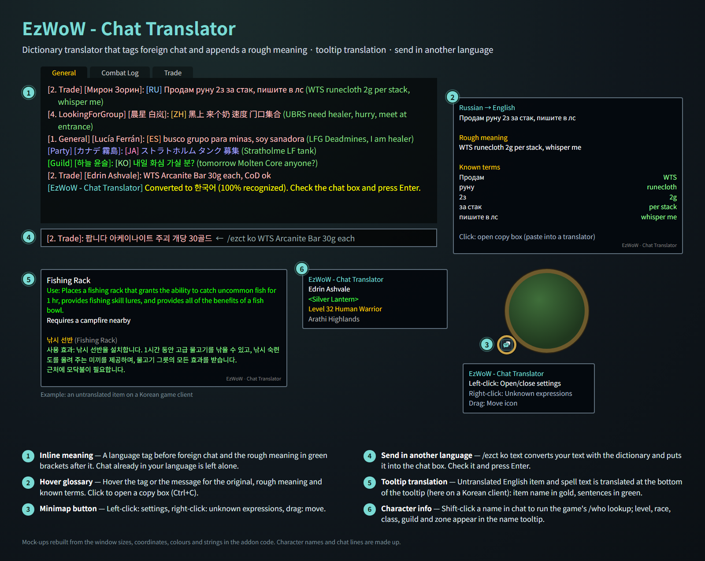
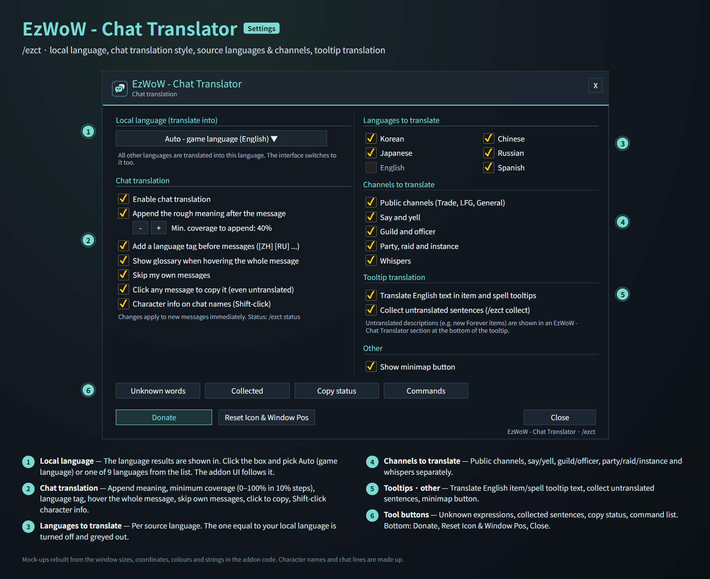
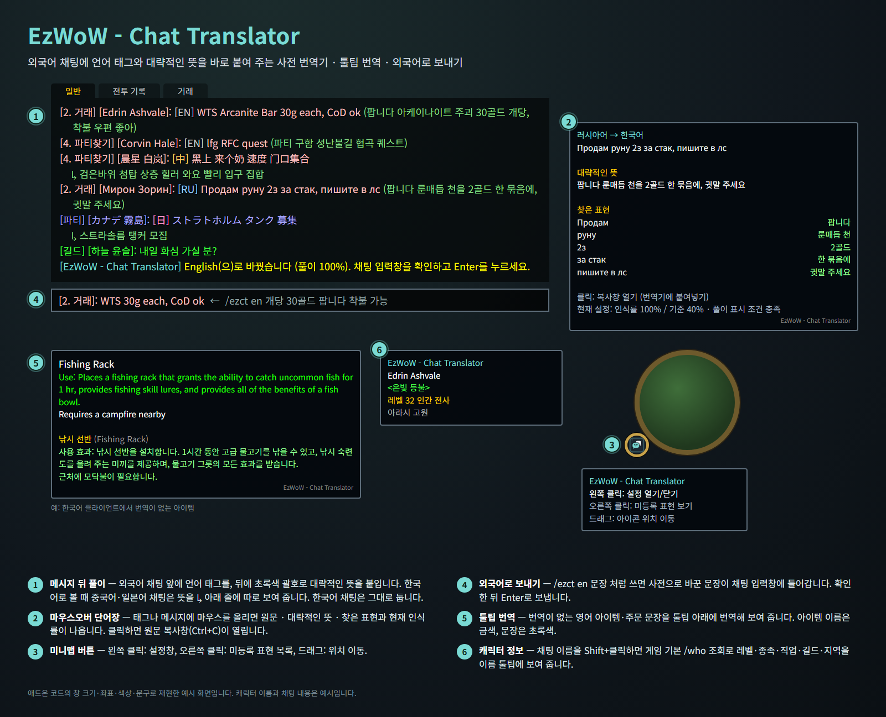
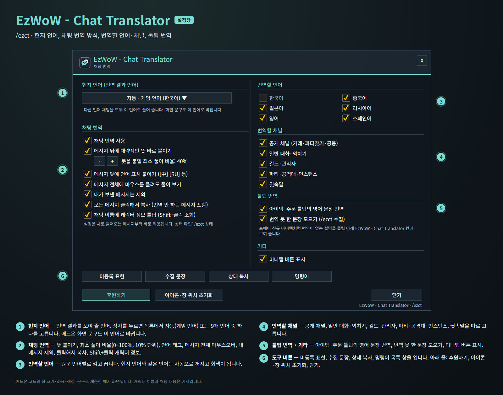

<!--
CurseForge summary (EN): Tags foreign chat with its language and a rough meaning from a built-in WoW dictionary, translates untranslated tooltips, and converts your messages into 9 languages.
CurseForge summary (KO): 외국어 채팅에 언어 태그와 대략적인 뜻을 붙이고, 미번역 툴팁을 번역하며, 내 메시지를 9개 언어로 바꿔 주는 내장 와우 사전 번역기.
-->

# EzWoW - Chat Translator

**English** · [한국어](#한국어)

A real-time dictionary translator for WoW Forever. Foreign chat gets a language tag and a rough meaning, built from a dictionary of 23,116 WoW terms, slang and abbreviations inside the addon (no online translation). It also translates untranslated item and spell tooltips, converts your own messages into another language and shows character info on chat names.

*Mock-ups rebuilt from the window sizes, coordinates, colours and strings in the addon code. Character names and chat lines are made up.*

## Features

### Chat translation
- A language tag (`[EN]` `[ZH]` `[RU]` `[JA]` `[ES]` `[KO]`) before foreign chat and the rough meaning in green brackets after it.
- With Korean as the result language, the meaning of Chinese and Japanese chat goes on its own `↳` line below the message.
- The meaning is only added when enough words are recognised (minimum coverage, 40% by default, 0–100%).
- Hover the tag or the message for the original text, rough meaning and every known term. Click to open a copy box (Ctrl+C).
- Understands numbers and LFG shorthand like `30g`, `1.5k`, `lvl40`, `lf2m`, `4=1`, keyboard-layout mistakes and stretched spellings (`invvvvv`).
- Choose which source languages (Korean, Chinese, Japanese, Russian, English, Spanish) and channels (public, say/yell, guild, party/raid/instance, whispers) are translated. Chat already in your language is left alone.

### Tooltip translation
- Untranslated English item, spell, set-bonus and profession text is translated at the bottom of the tooltip: item name in gold, sentences in green, with a small grey `EzWoW - Chat Translator` label underneath.
- Lines it cannot translate yet can be collected (`/ezct collect`).

### Send in another language
- `/ezct ko WTS 30g each` converts your text with the dictionary and puts it into the chat input box. Check it and press Enter. Parts it could not convert are listed in chat.

### Character info on chat names
- Shift + left-click a name in chat to run the game's /who lookup; level, race, class, guild and zone appear in the name tooltip. Party/raid members, your target and guild members show right away.

### More
- Your own words: `/ezct add word=meaning`, `/ezct del word`, `/ezct list`, and `/ezct search word` across the built-in dictionary and your words.
- Click any chat message to copy it, even untranslated ones (optional).
- Minimap button: left-click settings, right-click unknown expressions, drag to move.

## Commands
- `/ezct`, `/번역` or `/외국어` — open the settings
- `/ezct on` · `/ezct off` — toggle chat translation
- `/ezct lang <auto|ko|en|de|fr|es|ru|zhCN|zhTW|ja>` — change the result language
- `/ezct <en|de|fr|es|ru|zh|tw|ja|ko> text` — convert text into that language
- `/ezct unknown` · `/ezct collect` · `/ezct test text` · `/ezct status` · `/ezct help`

Result languages: 한국어, English, Deutsch, Français, Español, Русский, 简体中文, 繁體中文, 日本語 (German and French fall back to English where their tables are missing words).

---

## 한국어

WoW Forever용 실시간 사전 번역 애드온입니다. 외국어 채팅에 언어 태그와 대략적인 뜻을 붙여 주며, 애드온에 들어 있는 23,116개 와우 용어·은어·약어 사전으로 풀어 줍니다(인터넷 번역을 쓰지 않음). 번역이 없는 아이템·주문 툴팁 번역, 내 메시지를 외국어로 바꿔 보내기, 채팅 이름의 캐릭터 정보 툴팁도 있습니다.

*애드온 코드의 창 크기·좌표·색상·문구로 재현한 예시 화면입니다. 캐릭터 이름과 채팅 내용은 지어낸 예시입니다.*

## 기능

### 채팅 번역
- 외국어 채팅 앞에 언어 태그(`[EN]` `[中]` `[RU]` `[日]` `[ES]`)를, 뒤에 초록색 괄호로 대략적인 뜻을 붙입니다.
- 한국어로 볼 때 중국어·일본어 채팅의 뜻은 메시지 아래 `↳` 줄에 따로 보여 줍니다.
- 사전에서 찾은 비율이 최소 풀이 비율(기본 40%, 0~100%) 이상일 때만 뜻을 붙입니다.
- 태그나 메시지에 마우스를 올리면 원문, 대략적인 뜻, 찾은 표현과 현재 인식률이 나옵니다. 클릭하면 복사창(Ctrl+C)이 열립니다.
- `30g`, `1.5k`, `lvl40`, `lf2m`, `4=1` 같은 숫자·모집 표현, 한/영 자판 실수, `invvvvv` 같은 늘어진 철자도 알아듣습니다.
- 번역할 원문 언어(한국어·중국어·일본어·러시아어·영어·스페인어)와 채널(공개, 일반 대화·외치기, 길드, 파티·공격대·인스턴스, 귓속말)을 고를 수 있습니다. 내 언어로 쓴 채팅은 그대로 둡니다.

### 툴팁 번역
- 번역이 없는 영어 아이템·주문·세트 효과·전문기술 문장을 툴팁 아래에 번역해 보여 줍니다. 아이템 이름은 금색, 문장은 초록색이고 맨 아래에 작은 회색 글씨로 `EzWoW - Chat Translator`가 붙습니다.
- 아직 번역하지 못한 문장은 모아 둘 수 있습니다(`/ezct 수집`).

### 외국어로 보내기
- `/ezct en 개당 30골드 팝니다`처럼 쓰면 사전으로 바꾼 문장이 채팅 입력창에 들어갑니다. 확인한 뒤 Enter로 보냅니다. 바꾸지 못한 부분은 채팅창에 알려 줍니다.

### 채팅 이름 캐릭터 정보
- 채팅창의 이름을 Shift + 왼쪽 클릭하면 게임 기본 /who 조회로 레벨·종족·직업·길드·지역을 이름 툴팁에 보여 줍니다. 파티·공격대원, 대상, 길드원은 바로 보여 줍니다.

### 그 밖의 기능
- 나만의 단어장: `/ezct add 단어=뜻`, `/ezct del 단어`, `/ezct list`, 내장 사전과 내 단어를 함께 찾는 `/ezct 검색 단어`.
- 번역하지 않는 메시지도 클릭해서 복사(선택).
- 미니맵 버튼: 왼쪽 클릭 설정, 오른쪽 클릭 미등록 표현, 드래그로 이동.

## 명령어
- `/ezct`, `/번역` 또는 `/외국어` — 설정창 열기
- `/ezct 켜기` · `/ezct 끄기` — 채팅 번역 켜기/끄기
- `/ezct lang <auto|ko|en|de|fr|es|ru|zhCN|zhTW|ja>` — 결과 언어 바꾸기
- `/ezct <en|de|fr|es|ru|zh|tw|ja|ko> 문장` — 문장을 그 언어로 바꾸기
- `/ezct 미등록` · `/ezct 수집` · `/ezct 테스트 문장` · `/ezct 상태` · `/ezct 명령어`

결과 언어: 한국어, English, Deutsch, Français, Español, Русский, 简体中文, 繁體中文, 日本語 (독일어·프랑스어는 번역표에 없는 부분을 영어로 보여 줍니다).
